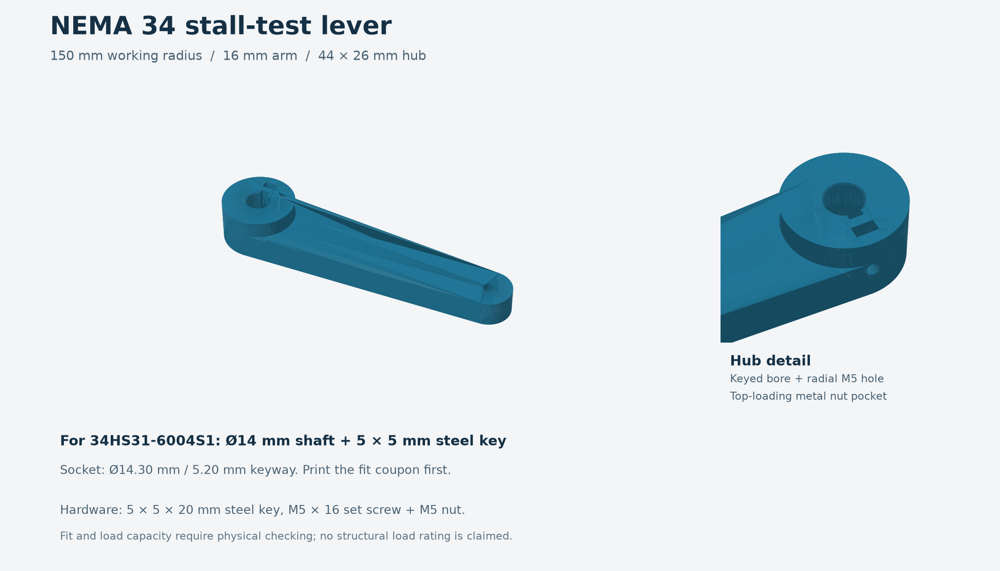

# Stall-test levers

Parametric [build123d](https://github.com/gumyr/build123d) levers for applying a measured load to a stepper motor shaft, including STL files for printing, STEP files for CAD, and small shaft-fit coupons.

All three levers have a **150 mm radius from the shaft axis to the end-hole centre**, a 6.5 mm end hole, and a captive metal nut for the radial set screw. Hardware is separate from the printable models.

| Model | Shaft interface | Arm thickness | Hardware | Files |
| --- | --- | --- | --- | --- |
| NEMA 17 | Assumed 5 mm D-shaft, 4.5 mm across D; 5.30 mm bore | 12 mm | M4 × 16 set screw + M4 nut | [STL](models/nema17/nema17_stall_lever.stl) · [STEP](models/nema17/nema17_stall_lever.step) · [Source](models/nema17/nema17_stall_lever.py) · [Fit coupon](models/nema17/nema17_shaft_fit_coupon.stl) |
| NEMA 23 | Assumed 8 mm D-shaft, 7.5 mm across D; 8.30 mm bore | 12 mm | M5 × 16 set screw + M5 nut | [STL](models/nema23/nema23_stall_lever.stl) · [STEP](models/nema23/nema23_stall_lever.step) · [Source](models/nema23/nema23_stall_lever.py) · [Fit coupon](models/nema23/shaft_fit_coupon.stl) |
| NEMA 34 — 34HS31-6004S1 | 14 mm keyed shaft; 14.30 mm bore and 5.20 mm hub keyway | 16 mm | 5 × 5 × 20 mm steel key, M5 × 16 set screw + M5 nut | [STL](models/nema34/nema34_stall_lever.stl) · [STEP](models/nema34/nema34_stall_lever.step) · [Source](models/nema34/nema34_stall_lever.py) · [Fit coupon](models/nema34/nema34_shaft_fit_coupon.stl) |

“Across D” means the distance from the flat face to the opposite circular edge. The D sockets add 0.15 mm clearance per surface. NEMA frame size alone does not determine shaft dimensions: print the fit coupon and check your actual shaft before printing the full lever.



## Printing and assembly

Print with the broad arm face on the bed and the hub upwards. Use a proven functional-part profile with substantial walls and a solid hub/root region. Clean the radial screw passage and the top-loading nut pocket as needed. The nut provides the screw thread; the printed passage is clearance only.

For the NEMA 34 model, a **separate steel key** bridges the motor-shaft groove and the hub groove. Install the key, slide on the lever, and tighten the set screw onto the key. Verify axial engagement and leave clearance between the lever and stationary motor face.

Detailed dimensions, hardware, fit assumptions, and assembly instructions:

- [NEMA 17 assembly notes](models/nema17/PRINT_AND_ASSEMBLY.txt) · [Preview](models/nema17/lever_preview.png)
- [NEMA 23 assembly notes](models/nema23/PRINT_AND_ASSEMBLY.txt) · [Preview](models/nema23/lever_preview.png)
- [NEMA 34 assembly notes](models/nema34/PRINT_AND_ASSEMBLY.txt)

### Printable NEMA 34 key — fit checking only

[Key STL](models/nema34/nema34_printed_key.stl) · [STEP](models/nema34/nema34_printed_key.step) · [Source](models/nema34/nema34_printed_key.py)

The printable key is **4.9 × 4.9 × 20 mm**, with 0.2 mm edge chamfers, for checking a nominal 5 × 5 mm key interface. Use a steel key for powered stall tests: the printed key can shear and release the lever.

## Measuring torque with a food scale

With the lever horizontal and force vertical, use the horizontal distance from the shaft centre to the actual scale contact point:

```text
torque_Nm = scale_grams × 9.80665 / 1000 × horizontal_distance_mm / 1000
scale_grams = torque_Nm / (horizontal_distance_mm / 1000) / 9.80665 × 1000
```

Examples at the 150 mm end-hole centre:

| Applied torque | Ideal scale reading |
| --- | --- |
| 2.4 N·m | 1,632 g |
| 4.8 N·m | 3,263 g |

The extreme tip is 162 mm from the shaft centre for NEMA 17/23 and 164 mm for NEMA 34; use that longer distance if it is the contact point. Advertised holding torque does not guarantee the same torque while moving; driver current and speed affect the result.

Secure the motor and scale, start with the lever already touching the scale, tare the initial load, and increase load slowly from low current and speed. Keep hands outside the sweep and avoid impacts. Stay within the scale's capacity. These printed levers have **not been physically load-tested or structurally rated**; valid CAD and watertight meshes do not establish strength.

## Regenerate the models

Tested with Python 3.12 and build123d 0.13.0.

```sh
python3.12 -m venv .venv
. .venv/bin/activate
python -m pip install -r requirements.txt
python scripts/build_models.py
python scripts/check_models.py
```

Edit the dimensions at the top of each model's Python source to change shaft fit, reach, or hardware clearances. Each source can also run on its own; it exports beside itself. The build script regenerates the three levers, fit coupons, and printable key. PNG previews are reference renders and are not regenerated by these scripts.

The check script reopens all STEP files, checks for one valid solid, verifies that each STL is one watertight mesh with consistent winding, compares STEP/STL bounds and volume, and checks shaft/key and hardware openings. Reports are written beside the models as `validation.json`.
